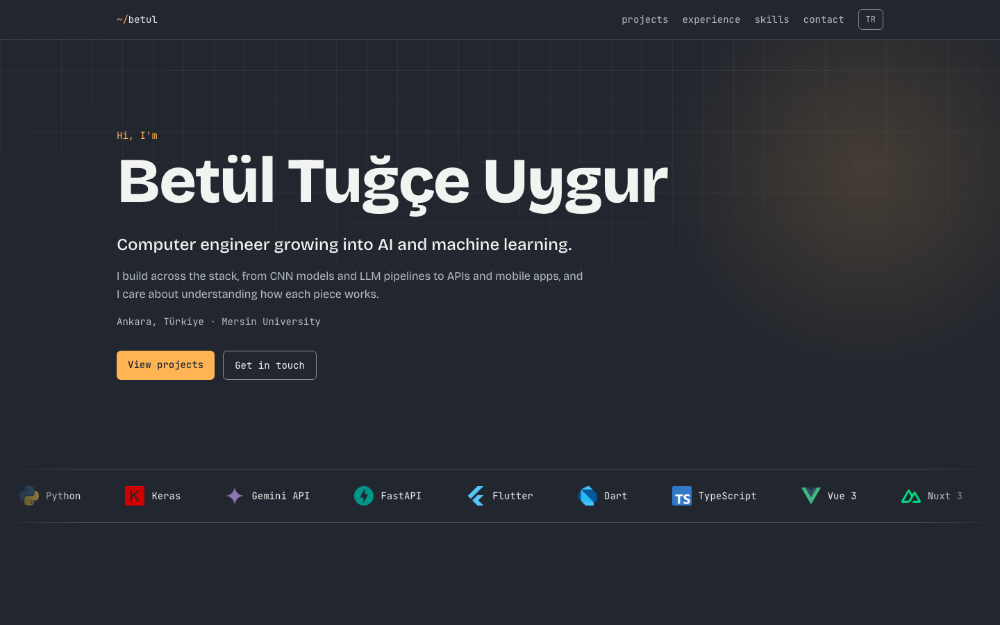

# Portfolio

Personal portfolio of Betül Tuğçe Uygur, a computer engineer focused on AI and machine learning. Static, bilingual (English and Turkish) site built with Astro and Tailwind CSS.

**Live:** [betultugceuygur.netlify.app](https://betultugceuygur.netlify.app)

## Demo



## Features

- English and Turkish pages built on Astro's i18n routing, with a language switch and `hreflang` tags
- Projects, experience and skills stored as typed data; adding a project means adding one record
- Bento-grid project cards and a CSS-only skills marquee that pauses on hover
- Scroll-in animations that turn off under `prefers-reduced-motion`
- Email address assembled in the browser and offered through a copy button, with a LinkedIn fallback when JavaScript is off
- SEO meta tags, an Open Graph image and optimized images through Astro's `<Image>` component
- Measured color contrast: text at least 6.9:1, control borders at least 3:1

## Tech Stack

- [Astro](https://astro.build) 7 (static output)
- [Tailwind CSS](https://tailwindcss.com) 4
- TypeScript
- Self-hosted Bricolage Grotesque and JetBrains Mono fonts
- [Netlify](https://www.netlify.com) (deploys on every push to `main`)

## Getting Started

Requires Node.js 22.12 or later. No environment variables are needed.

```bash
git clone https://github.com/Tuucelitto/Portfolio.git
cd Portfolio
npm ci
npm run dev
```

The development server runs at `http://localhost:4321`.

| Command           | Description                       |
| ----------------- | --------------------------------- |
| `npm run dev`     | Start the development server      |
| `npm run build`   | Build the production site         |
| `npm run preview` | Preview the production build      |

## Project Structure

```text
src/
├── assets/       Project screenshot and skill logos
├── components/   Single-purpose Astro components
├── data/         Typed content: projects, experience, skills, profile
├── i18n/         UI translations and language helpers
├── layouts/      Base layout with SEO tags
├── pages/        English routes, with Turkish routes under tr/
├── scripts/      Scroll reveal and card glow effects
└── styles/       Theme tokens and global styles
```

## What I Learned

- **i18n routing and data:** I used Astro's built-in routing for `/` and `/tr/`, and kept every string in one typed translation file or a `{ en, tr }` data field. TypeScript flags a missing translation key, so the two languages stay in sync.
- **Network-level debugging:** When the deployed link would not open, I checked each layer separately. A clean build and a successful deployment ruled out the code, and connecting to the same Vercel IP under different hostnames showed the connection was being reset based on the hostname. Comparing other hosting domains from the same network led me to move the site to Netlify.
